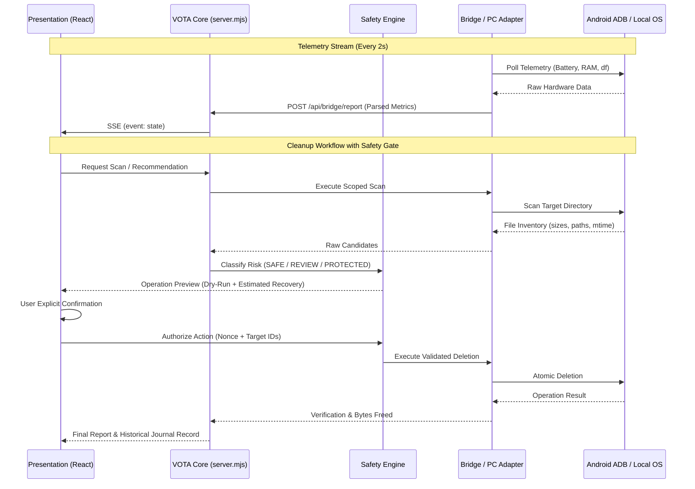

# VOTA Architecture Review & Technical Specification
**Project:** VOTA (Storage Intelligence & Device Optimization Platform)  
**Document:** Architecture Review & Proposed Target Design  
**Date:** 2026-10-30  
**Status:** Under Review (Stage C: Technical Specification)

---

## 1. Existing Architecture Analysis

### 1.1 Current Architecture Diagram

```
┌────────────────────────────────────────────────────────────────────────┐
│                          PRESENTATION LAYER                            │
│  React 19 SPA (Vite)                                                   │
│  ├── App.tsx (God Component: Holds all Android & PC mock state)         │
│  ├── StorageGauge.tsx (Hardcoded WhatsApp / Cache breakdown pills)      │
│  ├── FolderList.tsx (Static Android folder list)                       │
│  └── DeviceBanner.tsx (Hardcoded / partially dynamic telemetry)        │
└───────────────────────────────────┬────────────────────────────────────┘
                                    │ HTTP / SSE (/api/status, /api/events)
                                    ▼
┌────────────────────────────────────────────────────────────────────────┐
│                           SERVER LAYER                                 │
│  server.mjs (Native Node.js HTTP Server on port 5173)                  │
│  ├── Static File Server (dist/)                                        │
│  ├── In-Memory State Store (deviceState)                                │
│  ├── Dynamic Bridge Generator (/bridge.ps1, /bridge.py)                │
│  └── Unvalidated Command Queue (/api/exec, /api/bridge/report)         │
└───────────────────────────────────┬────────────────────────────────────┘
                                    │ HTTP Polling (every 2 seconds)
                                    ▼
┌────────────────────────────────────────────────────────────────────────┐
│                        LOCAL BRIDGE / ADB LAYER                        │
│  PowerShell 5.1+ (scripts/bridge.ps1) on Windows Laptop                │
│  ├── adb.exe devices                                                   │
│  ├── adb shell dumpsys battery                                         │
│  ├── adb shell cat /proc/meminfo                                       │
│  └── adb shell (raw command execution from server queue)               │
└────────────────────────────────────────────────────────────────────────┘
```

### 1.2 Identified Architectural Deficiencies

1. **God Component Anti-Pattern**:
   [`src/App.tsx#L21-L128`](file:///home/ubuntu/repos/storagepulse/src/App.tsx#L21-L128) maintains state for Android telemetry, Android storage, PC storage, mock folder items, bloatware items, command queues, and terminal logs simultaneously.
2. **Coupled Presentation & Telemetry**:
   [`src/components/StorageGauge.tsx#L62-L94`](file:///home/ubuntu/repos/storagepulse/src/components/StorageGauge.tsx#L62-L94) hardcodes storage category pills within the visual gauge component. PC Desktop view reuses this component, rendering mobile WhatsApp statistics on desktop drives.
3. **No Separation of Concerns between Android & PC**:
   There is no abstracted `DeviceAdapter` or `FilesystemAdapter`. PC actions execute simulated `setTimeout` functions directly in the UI component layer ([`src/App.tsx#L238-L256`](file:///home/ubuntu/repos/storagepulse/src/App.tsx#L238-L256)).
4. **Direct Shell String Injection**:
   [`src/lib/adbService.ts#L25-L31`](file:///home/ubuntu/repos/storagepulse/src/lib/adbService.ts#L25-L31) and [`server.mjs#L145-L177`](file:///home/ubuntu/repos/storagepulse/server.mjs#L145-L177) pass raw, un-escaped strings to `commandQueue`, which [`scripts/bridge.ps1#L137-L149`](file:///home/ubuntu/repos/storagepulse/scripts/bridge.ps1#L137-L149) invokes via `& $adb shell $cmd.command`.

---

## 2. Proposed Target Architecture

The target architecture establishes a clean, decoupled, modular structure where Android and PC Desktop operate as independent engines with unified safety and intelligence layers.

```
VOTA
├── Core
│   ├── Application Lifecycle (State Machine, Health, Context)
│   ├── Configuration (Environment, Tolerances, Paths)
│   ├── Logging & Event Bus (Typed Event Stream, Persistent Journal)
│   ├── Error Handling & Recovery (Standardized Codes, User Guidance)
│   └── Permissions & Security (Auth Token, Command Whitelist, Sandboxing)
│
├── Android Engine
│   ├── ADB Manager (Lifecycle, Authorization, Port Forwarding, Wireless)
│   ├── Device Discovery & Identity (Serial, Model, Manufacturer, Android Version)
│   ├── Telemetry Monitor (Battery, Thermal, RAM, Storage via /proc & dumpsys)
│   ├── Storage Analyzer (df, du, Scoped Storage Navigation /sdcard)
│   ├── Application Analyzer (pm list packages, dump meminfo, cache trim)
│   ├── WhatsApp Analyzer (Media structure: Sent vs Received, Documents, Audio)
│   ├── Duplicate Detector (Hash & size correlation across user storage)
│   └── Cleanup Engine (Validated, scoped, atomic file removal)
│
├── PC Engine
│   ├── Drive Discovery (Windows logical drives C:\, D:\, Linux mount points)
│   ├── Filesystem Scanner (Statvfs, Breadth-First directory traversal)
│   ├── Storage Analyzer (Category aggregation by MIME & file extension)
│   ├── Duplicate Detector (Size bucket pre-filter -> SHA-256 chunked hash)
│   ├── Temporary File Analyzer (%TEMP%, Prefetch, /tmp, Browser Caches)
│   ├── Hardware Health (Real S.M.A.R.T. queries or transparent "Unavailable" flag)
│   └── Cleanup Engine (OS-specific recyclable/atomic deletion with dry-run)
│
├── Intelligence Engine
│   ├── Storage Classification (Dynamic categorization: Media, Apps, Docs, System)
│   ├── Cleanup Recommendations (Confidence scoring, space-vs-risk heuristic)
│   ├── Device Health Score (Transparent calculation: Thermal + RAM + Storage pressure)
│   └── Storage Forecast (Linear regression on historical storage telemetry)
│
├── Safety Engine
│   ├── Risk Classification (SAFE, REVIEW REQUIRED, PROTECTED, UNKNOWN)
│   ├── Protected Paths Policy (Operating system roots, system apps, bootloader)
│   ├── Operation Preview & Dry-Run (Candidate inventory, recovery estimation)
│   ├── Explicit Confirmation (Cryptographic/Nonce confirmation for destruction)
│   └── Audit History (Immutable local journal of all performed operations)
│
└── Presentation Layer (React 19 / Modern UI)
    ├── Dashboard (Unified or Mode-switched high-level overview)
    ├── Android Hub (Device Overview, App Manager, WhatsApp, Bloatware)
    ├── PC Desktop Hub (Drive Analyzer, Treemap Explorer, Temp Cleaner)
    ├── Intelligence Center (Recommendations, Health Score, Forecast)
    ├── Cleanup Safety Center (Preview, Confirmation Dialog, Progress, Report)
    └── Activity Log & Terminal (Real-time telemetry, execution transcripts)
```

---

## 3. Platform Adapter Strategy

To ensure zero shared mock data and platform correctness:

### 3.1 Android Adapter (`AndroidAdapter`)
- **Transport**: ADB over USB or TCP (Wireless Debugging port 5555/pairing).
- **Execution**: Structured argument array `['shell', 'cmd', 'package', ...]` instead of concatenated strings.
- **Permission Boundary**: Operates strictly within non-root ADB shell privileges (`user 0`). Explicitly handles `PermissionDenied` and Android 11+ Scoped Storage restrictions (`/sdcard/Android/data` inaccessible without root).
- **Measurement Source**: `df -k /data`, `dumpsys battery`, `cat /proc/meminfo`.

### 3.2 PC Desktop Adapter (`PcDesktopAdapter`)
- **Transport**: Native Node.js system calls and platform-specific commands.
- **Windows Implementation**:
  - Drive Discovery: `Get-CimInstance Win32_LogicalDisk` or Node `fs.statfs`.
  - Temp Directory: Canonical path `$env:TEMP` / `C:\Users\<user>\AppData\Local\Temp`.
  - Health: Queries `Get-PhysicalDisk | Select DeviceId, FriendlyName, OperationalStatus, HealthStatus`. If elevated permissions are absent, reports `Health: Hardware SMART Unavailable (Requires Admin)` rather than a fake `100%`.
- **Linux Implementation**:
  - Drive Discovery: `/bin/df -B1` and `/proc/mounts`.
  - Temp Directory: `/tmp` and `~/.cache`.
  - Health: `smartctl` (if installed) or flag as `Unsupported without root`.

---

## 4. Data Flow Specifications



---

## 5. Architectural Recommendations & Migration Roadmap

1. **Decouple `StorageGauge`**:
   Refactor `StorageGauge` to accept generic `breakdownItems: Array<{ label: string, sizeGb: number, color: string }>` instead of hardcoded JSX strings.
2. **Implement Safe Command Dispatcher**:
   Replace arbitrary string execution in `/api/exec` with predefined action IDs:
   - `ACTION_TRIM_CACHE` -> dispatches verified `pm trim-caches 999G`
   - `ACTION_UNINSTALL_PACKAGE` -> validates package name against regex `^[a-zA-Z0-9._]+$` before invoking `pm uninstall`
   - Disallow arbitrary shell execution.
3. **Build Native PC Filesystem Provider**:
   Expose `/api/pc/drives` and `/api/pc/scan` on `server.mjs` using Node.js `fs.promises` and `fs.statfs` to read real Windows and Linux drives.
4. **Persist History Locally**:
   Store operation history and telemetry logs in local JSON or SQLite (`vota-history.json`) for historical auditing.
